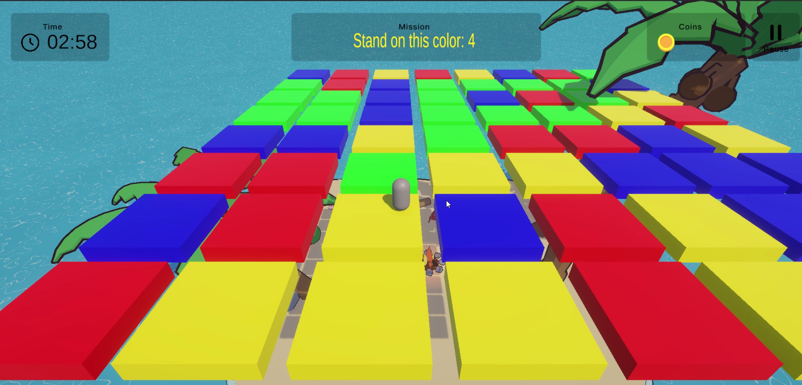

# TODO: Game Title

A 3D mini-game made in Unity for the Game Development course (CS-CADT, Year 3, Term 1). You play as Blob, a small bean with floating hands and feet, and you have to collect coins before time runs out without falling off the platforms.



## Contents

- [Objective](#objective)
- [Rules](#rules)
- [Controls](#controls)
- [Requirements](#requirements)
- [Setup and play](#setup-and-play)
- [Team members and contributions](#team-members-and-contributions)
- [Assets and tutorial references](#assets-and-tutorial-references)
- [Gameplay video](#gameplay-video)
- [Playable build](#playable-build)

## Objective

Collect all the required coins before the timer reaches zero.

## Rules

- You win if you collect every required coin before the timer runs out.
- You lose if the timer runs out first, if you fall off the platforms, or if a moving wall hits you.
- Each round, the top of the screen shows a safe color. When the countdown ends, every platform of another color disappears, so stand on the safe color.
- Walls slide across the arena in your lane. Jump over them or dash out of the way.

## Controls

| Key                     | Action                             |
| ----------------------- | ---------------------------------- |
| `W` `A` `S` `D` | Move                               |
| `Space`               | Jump (only on the ground)          |
| `Left Shift`          | Dash (short burst, has a cooldown) |
| Pause button (mouse)    | Pause and resume the game          |

## Requirements

| Item            | Version                                |
| --------------- | -------------------------------------- |
| Unity           | 6000.3.8f1 (Unity 6.3 LTS)             |
| Render pipeline | Universal Render Pipeline (URP) 17.3.0 |
| Input           | Input System 1.18.0                    |
| UI              | uGUI 2.0.0, TextMesh Pro               |
| OS              | Windows or macOS (Linux not tested)    |

Open the project with Unity `6000.3.8f1`. Another version will upgrade the project files.

## Setup and play

### Play in the Unity Editor

1. Clone the repository:
   ```
   git clone https://github.com/sochan707/mini-game-pj.git
   ```
2. Open Unity Hub, click Add, then Add project from disk, and select the `mini-game-pj` folder.
3. Open the project with Unity `6000.3.8f1`. The first open takes a few minutes while Unity imports the assets.
4. Open `Assets/Scenes/MainMenu.unity`.
5. Press Play, then click Start.

### Play the build

1. Download the build from the [playable build](#playable-build) link.
2. Unzip it.
3. Run the game executable.

### Make a build yourself

1. In Unity, open File > Build Profiles.
2. Check that the scene list has `MainMenu` first, then `SampleScene`.
3. Pick your platform and click Build.

### Scenes

| Scene           | Purpose              |
| --------------- | -------------------- |
| `MainMenu`    | Start and Quit       |
| `SampleScene` | Gameplay             |
| `EndGame`     | Win and lose screens |

## Team members and contributions

| Member                                           | GitHub               | Contributions                                                                                                                                                 |
| ------------------------------------------------ | -------------------- | ------------------------------------------------------------------------------------------------------------------------------------------------------------- |
| Game UI, Main programmer                         | Sarin Meas Sochan    | Project setup, repository owner, pull request reviews and merges. Main menu and Start page, moving walls and wall spawner, coin collection, green tile, etc. |
| Game UI, gameplay maker, assets                  | Kaing Menglay        | Sample scene and prefabs, URP settings, gameplay HUD (timer, coins, pause), mission UI, map                                                                   |
| Game UI, Game screen interactions, Game Desginer | Phea Sreynith        | Color materials, End Game screen (win and lose panels)                                                                                                        |
| Player movemeent                                 | Chhon Chhaychanvibol | Player movement (walk, jump, dash, facing), camera follow, color platform rounds, Blob 3D model                                                               |


## Assets and tutorial references

* [assetstore.unity.com/packages/3d/environments/landscapes/toon-tropical-lite-free-stylized-island-starter-421052](https://assetstore.unity.com/packages/3d/environments/landscapes/toon-tropical-lite-free-stylized-island-starter-421052)

### Unity packages

- [Universal Render Pipeline](https://docs.unity3d.com/Packages/com.unity.render-pipelines.universal@17.3/manual/index.html)
- [Input System](https://docs.unity3d.com/Packages/com.unity.inputsystem@1.18/manual/index.html)
- [TextMesh Pro](https://docs.unity3d.com/Packages/com.unity.ugui@2.0/manual/TextMeshPro/index.html)

### Art

| File                                                                                                                                                            | Use                 | Source                                                                                                                                                                                                                                    |
| --------------------------------------------------------------------------------------------------------------------------------------------------------------- | ------------------- | ----------------------------------------------------------------------------------------------------------------------------------------------------------------------------------------------------------------------------------------- |
| `Assets/Texture/winLost_bg.jpg`                                                                                                                               | End Game background | DIY                                                                                                                                                                                                                                       |
| `Assets/Texture/sky backgroud.jpeg`, `sky2.jpg`, `4161612.jpg`, `blue-sky-and-cloud-abstract-nature-landscape-cartoon-background-decoration-vector.jpg` | Backgrounds         | [assetstore.unity.com/packages/3d/environments/landscapes/toon-tropical-lite-free-stylized-island-starter-421052](https://assetstore.unity.com/packages/3d/environments/landscapes/toon-tropical-lite-free-stylized-island-starter-421052) |
| `Assets/Texture/clock.png`, `Coins.png`, `Pause.png`                                                                                                      | HUD icons           | DIY and other assets                                                                                                                                                                                                                      |
| Blob character                                                                                                                                                  | Player model        | Blender, hand-drawn, and model                                                                                                                                                                                                            |

### Tutorials

- none

## Gameplay video

* [Watch the gameplay demo (MP4)](https://drive.google.com/file/d/1H5G6QEVo2FXxZX5zylUwr4MrscoKr2Pt/view?usp=drivesdk)

## Playable build

* Link:
